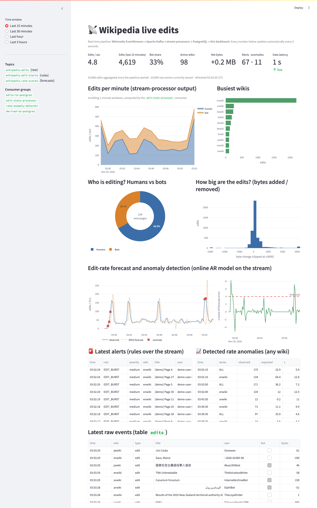
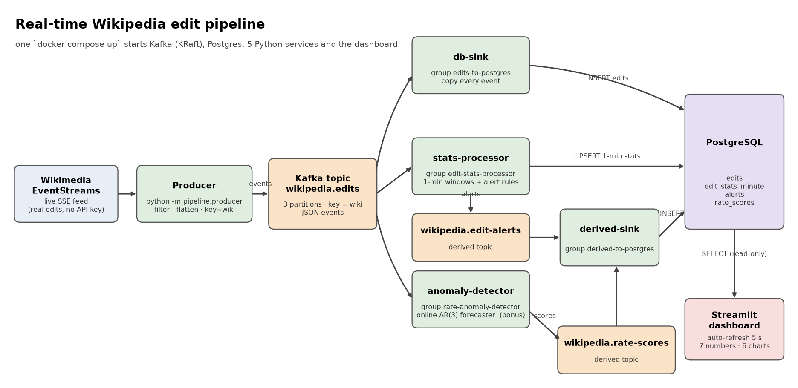
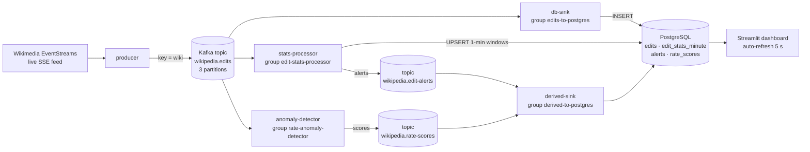
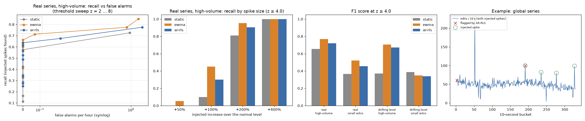
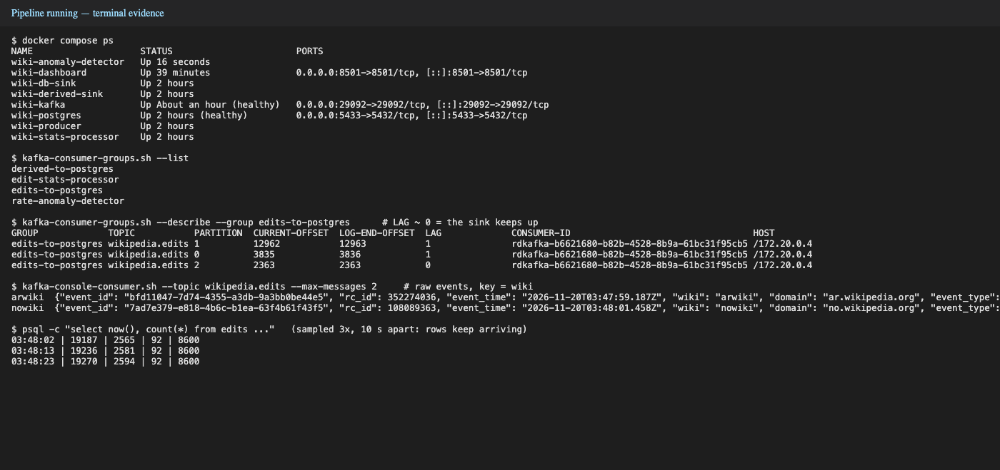

# 📡 Wikipedia Live Edits — a real-time Kafka pipeline

> **Live dashboard:** *(public link is added here after deployment — see [How the public dashboard is deployed](#how-the-public-dashboard-is-deployed))*
> *(auto-refreshes every 5 s — nothing to install, just open the link)*



*Screenshot of the running dashboard right after a demo burst (red ✕ = detected anomalies).*

Every few seconds, people and bots edit Wikipedia somewhere in the world. This project turns that firehose into a
production-style streaming system: the live edit feed goes into **Apache Kafka**, independent **consumers** store it in
**PostgreSQL**, **stream processors** compute rolling statistics, rule-based alerts and an **online anomaly-detection
model** while the data flows, and a **Streamlit** dashboard shows everything live.

| Rubric part | Where it is |
|---|---|
| 1. Source + producer | [`pipeline/producer.py`](pipeline/producer.py) — real, live Wikimedia EventStreams feed |
| 2. Kafka | topic `wikipedia.edits` (key = `wiki`), own consumer group per job — see [Kafka design](#2-kafka-design) |
| 3. Database | table `edits` in Postgres, one column per event field — [`pipeline/db_sink.py`](pipeline/db_sink.py) |
| 4. Stream processing | 1-minute windows, 3 alert rules, forecast/anomaly scores → tables `edit_stats_minute`, `alerts`, `rate_scores` |
| 5. Dashboard | [`dashboard/app.py`](dashboard/app.py) — 7 numbers, 6 charts, derived results, auto-refresh |
| **Bonus: sequential modelling** | online **AR(3) forecaster (recursive least squares)** that detects anomalies in the edit-rate series, evaluated against two baselines — [see below](#bonus--sequential-modelling-anomaly-detection-on-the-stream) |

---

## 1. Data source

**Wikimedia EventStreams** (`https://stream.wikimedia.org/v2/stream/recentchange`) — the public, real-time feed of every
change made on Wikimedia projects, delivered as Server-Sent Events. No API key is needed; Wikimedia only asks clients to
identify themselves with a `User-Agent` (set `WIKI_USER_AGENT` in `.env`). The producer keeps the `edit` and `new-page`
events of the Wikipedia language editions (`*.wikipedia.org`), roughly **5–8 events per second, around the clock**.

It meets the three data rules of the assignment:

| Rule | How |
|---|---|
| Not the in-class online-store orders | Wikipedia edits |
| ≥ 6 fields incl. unique id, timestamp, category, numeric | **15 fields** (below): `event_id` (UUID), `event_time`, `wiki` (category), `byte_delta` (numeric), … |
| Keeps producing for ≥ 5 minutes with no help | It is a live feed: it produces continuously for as long as the producer runs (it reconnects automatically if the connection drops) |

**Event schema** (one Kafka message = one row of table `edits`):

| field | type | meaning |
|---|---|---|
| `event_id` | text (UUID) | unique id of the event (Wikimedia `meta.id`) — primary key |
| `rc_id` | bigint | recent-change id on that wiki |
| `event_time` | timestamptz | when the edit happened |
| `wiki` | text | **category**: `enwiki`, `dewiki`, `jawiki`, … |
| `domain` | text | e.g. `en.wikipedia.org` |
| `event_type` | text | `edit` or `new` (new page) |
| `namespace` | int | 0 = article, 1 = talk, 2 = user, … |
| `title` | text | page title |
| `user_name` | text | editor (or IP address) |
| `is_bot`, `is_minor` | boolean | flags set by the editor / MediaWiki |
| `length_old`, `length_new` | int | page size in bytes before / after |
| `byte_delta` | int | **numeric**: `length_new − length_old` (how much text was added or removed) |
| `comment` | text | edit summary |

## Architecture





## 2. Kafka design

| Topic | Written by | Read by (consumer group) | Content |
|---|---|---|---|
| `wikipedia.edits` (3 partitions) | producer | `edits-to-postgres`, `edit-stats-processor`, `rate-anomaly-detector` | raw edits, key = `wiki` |
| `wikipedia.edit-alerts` | stats-processor | `derived-to-postgres` | rule-based alerts (derived) |
| `wikipedia.rate-scores` | anomaly-detector | `derived-to-postgres` | forecast + anomaly score per 10 s bucket (derived) |

**Message key = `wiki`** — Kafka sends all messages with the same key to the same partition, so every edit of one wiki stays in order and
the stateful processors (windows, per-page burst detection, per-wiki forecasting) can keep their state for a wiki without any coordination between consumers.

**Consumer groups.** Each job has its *own* group, so each gets a full copy of the stream and can fall behind, crash or be redeployed independently.
(Scaling one job out = starting more instances with the same group id; Kafka then splits the 3 partitions among them.)

**Delivery guarantees.** Consumers disable auto-commit and commit offsets only *after* their output is safely stored (Postgres commit / Kafka flush) → at-least-once.
Writes are idempotent (`INSERT … ON CONFLICT DO NOTHING` on `event_id`, deterministic `alert_id`s, upserts), so a replay after a crash cannot create duplicates.
I verified this by restarting the broker while the stream was running — all consumers reconnected and row counts kept growing.

## 3. Database (PostgreSQL)

| Table | Filled by | Rows grow while the producer runs? |
|---|---|---|
| `edits` | `db-sink` | yes — one row per event, columns = event schema above (pruned after `RETENTION_HOURS`, default 6 h, to keep the DB small) |
| `edit_stats_minute` | `stats-processor` | yes — one row per (wiki, minute) |
| `alerts` | `derived-sink` (from `wikipedia.edit-alerts`) | when a rule fires |
| `rate_scores` | `derived-sink` (from `wikipedia.rate-scores`) | yes — every 10 s per tracked series |

Schema: [`pipeline/schema.sql`](pipeline/schema.sql) (created automatically at start-up).

## 4. Stream processing (derived results)

Three consumers do more than copy; each writes its result to a topic and/or table that updates while the stream runs:

1. **Tumbling 1-minute windows per wiki** (`stats-processor`, event time) → table `edit_stats_minute`: edits, bot vs human edits, new pages, bytes added / removed, unique editors. Rows are re-upserted every 5 s while a window is still filling.
2. **Alert rules** (`stats-processor` → topic `wikipedia.edit-alerts` → table `alerts`):
   * `MASS_DELETION` — a human edit removes ≥ 10 000 bytes (page blanking / vandalism candidate)
   * `EDIT_BURST` — ≥ 5 edits by ≥ 3 different users on one page within 5 minutes (edit war or breaking news)
   * `HIGH_RATE_USER` — a non-bot account makes ≥ 20 edits in a minute (script / spam candidate)
3. **Online forecasting + anomaly scoring** (`anomaly-detector` → topic `wikipedia.rate-scores` → table `rate_scores`) — the bonus, described next.

## 5. Dashboard (Streamlit)

[`dashboard/app.py`](dashboard/app.py) refreshes itself every 5 seconds (`st.fragment(run_every=5)`, no reload button).

* **7 summary numbers:** edits/s, edits in window, bot share, active wikis, net bytes, alerts · anomalies, data latency (is the pipeline live?)
* **6 charts:** edits per minute (human vs bot, stacked area), busiest wikis, humans-vs-bots donut, edit-size histogram, observed-vs-forecast edit rate with anomalies marked, z-score of the forecast error
* **Derived results:** the per-minute stats feed the throughput charts; tables of the latest **alerts** and **detected anomalies**; plus a live view of the raw `edits` table.

---

## Bonus — sequential modelling: anomaly detection on the stream

**Goal:** notice, within seconds, when the edit rate of Wikipedia (or of one wiki) jumps far above what the recent past predicts — a bot run, a breaking-news surge, a vandalism wave.

**Model** ([`pipeline/anomaly.py`](pipeline/anomaly.py), service [`pipeline/anomaly_detector.py`](pipeline/anomaly_detector.py)).
The series is *edits per 10-second bucket* (global + every busy wiki), built from event time.
1. Counts are roughly Poisson, so each bucket is variance-stabilised with the Anscombe transform `y = 2·√(x + 3/8)`.
2. An **AR(3) model with bias is trained online by recursive least squares with forgetting** (λ = 0.995): for each new bucket it first **forecasts**, then sees the truth, then updates its weights — no batch re-training, it follows the daily rhythm by itself.
3. The anomaly score is the standardised one-step-ahead forecast error `z`; a bucket is flagged when `z ≥ 4` and it holds ≥ 6 edits (and after a 3-minute warm-up). If the whole stream goes silent for > 30 s (outage), those empty buckets are skipped instead of being scored as “0 edits”.

Every scored bucket is published to Kafka (`wikipedia.rate-scores`) and shown on the dashboard (forecast line, red ✕ on anomalies, z-score chart).

**Evaluation.** A real stream has no anomaly labels, so I built them ([`scripts/evaluate_anomaly.py`](scripts/evaluate_anomaly.py)):
take the real stored series (0.9 hours of live data, global + the 5 busiest wikis), multiply randomly chosen buckets by (1 + m) with m ∈ {0.5, 1, 2, 4} (a +50 % … +400 % surge in a 10-second bucket) and check which detectors find them.
Compared: a **static** z-score (mean/std of the first 25 % of the series, never updated), an **EWMA** level, and the **online AR(3)-RLS** used in the pipeline.



| setting | detector | precision | recall | F1 | false alarms / h |
|---|---|---|---|---|---|
| real series, high-volume (global, enwiki) (n=80 spikes) | static z-score | 1.00 | 0.49 | 0.66 | 0.00 |
|  | EWMA | 1.00 | 0.62 | 0.77 | 0.00 |
|  | **online AR(3)-RLS** (pipeline) | 1.00 | 0.56 | 0.72 | 0.00 |
| real series, small wikis (n=105 spikes) | static z-score | 0.64 | 0.26 | 0.37 | 0.55 |
|  | EWMA | 0.75 | 0.40 | 0.52 | 0.51 |
|  | **online AR(3)-RLS** (pipeline) | 0.71 | 0.33 | 0.46 | 0.51 |
| real + simulated level drift, high-volume (global, enwiki) (n=79 spikes) | static z-score | 0.24 | 0.80 | 0.37 | 14.56 |
|  | EWMA | 1.00 | 0.54 | 0.70 | 0.00 |
|  | **online AR(3)-RLS** (pipeline) | 1.00 | 0.51 | 0.67 | 0.00 |
| real + simulated level drift, small wikis (n=132 spikes) | static z-score | 0.59 | 0.29 | 0.39 | 0.96 |
|  | EWMA | 1.00 | 0.21 | 0.35 | 0.00 |
|  | **online AR(3)-RLS** (pipeline) | 1.00 | 0.20 | 0.34 | 0.00 |

Recall by spike size on the real high-volume series — AR-RLS: +50%: 0%, +100%: 30%, +200%: 90%, +400%: 100%; EWMA: +50%: 5%, +100%: 45%, +200%: 95%, +400%: 100%. (z ≥ 4, ≥ 6 edits in the bucket.)

**Discussion.**
1. **Online adaptation matters once the level moves.** On the real hour the traffic is almost stationary, so even a static threshold works (F1 0.66). When I add a *simulated* slow day/night-style drift (level 0.6× → 2×), the static detector collapses — precision 0.24 and 14.6 false alarms per hour on the high-volume series — while both online models keep **0 false alarms** and F1 ≈ 0.7. A model that learns while the stream flows is what a never-ending stream needs.
2. **The AR(3) model did not beat the simple EWMA here.** EWMA has slightly higher recall (F1 0.77 vs 0.72 on the real high-volume series); with ~80 injected spikes that gap is within noise. The likely reason is that edits per 10 s behave like noise around a slowly moving level, so extra autoregressive terms have little structure to exploit. I kept the AR model in the pipeline because it is a genuine sequential *forecaster* (its one-step forecast is what the dashboard plots), it matches EWMA on precision, and it can pick up short-term structure that EWMA cannot — but I do not claim it is better on this data.
3. **Big surges are found, small ones are not.** Spikes of +200 % and +400 % are caught in > 90 % of cases; +50 % / +100 % rarely, because a 10-second bucket already fluctuates by roughly ±20 % — those are not distinguishable from noise at `z ≥ 4`. Lowering the threshold trades recall for false alarms (see the left panel of the figure).
4. **Small wikis are hard.** With only a handful of edits per bucket the counts are dominated by Poisson noise: recall is 0.2–0.4 at precision ≈ 0.7. That is why the dashboard's main chart tracks the global series, and per-wiki series are only scored when the wiki has ≥ 40 edits in the last 30 minutes.
5. **Caveats.** The anomalies are *injected* (no real labels exist) and the evaluation uses 0.9 h of outage-free data (about 1.5 h collected; 32 min removed because collection was interrupted, e.g. laptop sleep and broker restarts — a first version of this evaluation that did not remove them was badly misleading, so the script now detects and cuts those gaps). Treat the numbers as indicative; `python scripts/evaluate_anomaly.py` re-runs the whole experiment on whatever data is in your database. On the live stream the detector reacted to injected demo bursts within one or two 10-second buckets (z between 4.6 and 12.8).

**Live demo of the detector.** `python scripts/inject_burst.py` injects ~20 s of clearly-labelled synthetic edits (users `demo-*`, titles `[demo] …`) into Kafka; within one or two 10-second buckets the dashboard shows the anomaly and the `EDIT_BURST` / `MASS_DELETION` alerts (see the screenshot at the top: the red ✕ marks).

*Flink.* I chose sequential modelling rather than Apache Flink for the extension: the windowed aggregation part (tumbling windows) is already implemented by hand in `stats_processor.py`, and the AR model needs per-key state that is simplest to keep in a Kafka consumer.

---

## Run it yourself

**Prerequisites:** Docker Desktop (with Compose v2). Nothing else — Kafka, Postgres and all Python services run in containers.

```bash
git clone https://github.com/hanhan572/wiki-kafka-pipeline.git
cd wiki-kafka-pipeline
cp .env.example .env          # optional: set WIKI_USER_AGENT to your contact; defaults work out of the box
docker compose up -d --build  # starts Kafka, Postgres, producer, 4 consumers/processors and the dashboard
```

Open **http://localhost:8501** — the dashboard fills within a few seconds (the forecast chart needs ~3 minutes of warm-up).

Check that every stage is alive (this is what it looks like when it runs):




```bash
docker compose ps                                                     # all services "Up"
docker compose logs -f producer                                       # "produced N events total (6.0/s)"
docker exec wiki-kafka /opt/kafka/bin/kafka-console-consumer.sh \
    --bootstrap-server localhost:9092 --topic wikipedia.edits --max-messages 3      # raw events
docker exec wiki-kafka /opt/kafka/bin/kafka-consumer-groups.sh \
    --bootstrap-server localhost:9092 --describe --group edits-to-postgres          # lag per partition
docker exec wiki-postgres psql -U wiki -d wiki -c "select count(*), max(event_time) from edits"   # grows every second
```

Stop with `docker compose down` (add `-v` to also delete the stored data). Run the unit tests with `pip install -r requirements.txt pytest && pytest`.

| Service (container) | Command | Kafka group |
|---|---|---|
| `producer` | `python -m pipeline.producer` | – |
| `db-sink` | `python -m pipeline.db_sink` | `edits-to-postgres` |
| `stats-processor` | `python -m pipeline.stats_processor` | `edit-stats-processor` |
| `anomaly-detector` | `python -m pipeline.anomaly_detector` | `rate-anomaly-detector` |
| `derived-sink` | `python -m pipeline.derived_sink` | `derived-to-postgres` |
| `dashboard` | `streamlit run dashboard/app.py` | – |

### Configuration & secrets
All settings are environment variables ([`.env.example`](.env.example) lists them). **No passwords or keys are committed**: `.env` and `.streamlit/secrets.toml` are git-ignored; the local database password in `docker-compose.yml` is only a default for a database that is reachable from your own laptop.

## How the public dashboard is deployed

The public dashboard is a free **Hugging Face Space** (Docker) running the *whole* pipeline in one container
([`deploy/huggingface/`](deploy/huggingface)): Kafka in KRaft mode, the producer, all consumers/processors and the Streamlit app, writing to a free **Supabase** Postgres.
Because Kafka and the processors live in the Space, the link keeps showing live data with nothing running on my laptop.

1. Supabase → new project → *Connect* → copy the **Session pooler** connection string (`postgresql://postgres.<ref>:<password>@aws-0-<region>.pooler.supabase.com:5432/postgres`).
2. Hugging Face → *New Space* → SDK **Docker**, blank template.
3. Space → *Settings* → *Variables and secrets* → new **secret** `DATABASE_URL` = the Supabase string (and optionally `WIKI_USER_AGENT`).
4. `scripts/deploy_hf.sh <hf-username>/<space-name>` (asks for your HF username and a *write* access token) → the Space builds and starts.

(A free Space goes to sleep after 48 h without visitors and wakes up when someone opens the link; the history in Supabase is kept.)

## Repository layout

```
├── docker-compose.yml          # Kafka (KRaft) + Postgres + 5 pipeline services + dashboard
├── Dockerfile                  # one image for all Python services
├── .env.example                # all configuration, no secrets
├── pipeline/
│   ├── producer.py             # Part 1 – Wikimedia SSE → Kafka
│   ├── db_sink.py              # Part 3 – Kafka → Postgres `edits`
│   ├── stats_processor.py      # Part 4 – windows + alert rules
│   ├── processing.py           #          (pure, unit-tested logic)
│   ├── anomaly_detector.py     # Bonus  – online forecaster service
│   ├── anomaly.py              #          (EWMA + AR-RLS models)
│   ├── derived_sink.py         # derived topics → Postgres
│   ├── kafka_utils.py, db.py, config.py, schema.sql
├── dashboard/app.py            # Part 5 – Streamlit
├── deploy/huggingface/         # all-in-one image for the public Space
├── scripts/                    # evaluate_anomaly.py, inject_burst.py, make_diagram.py, screenshot.py, deploy_hf.sh
├── tests/                      # pytest: windows, alert rules, producer flattening, AR model
└── docs/, images/              # diagram, evaluation results, screenshots
```

## Limitations / next steps
* Window state of `stats-processor` lives in memory; after a restart the current minute is rebuilt from the replayed events and counters never decrease (`GREATEST` upsert), so a restart can under-count that one minute.
* The anomaly detector keeps its model state in memory: after a restart it needs the 3-minute warm-up again.
* Single-broker Kafka with replication factor 1 — fine for a demo, not for production.
* Raw events are pruned after 6 hours to keep the free-tier database small; the per-minute aggregates are kept for 7 days.
* The anomaly detector watches the edit *rate*; a content-level model (e.g. vandalism classification of the edit text) would be a natural next step.
